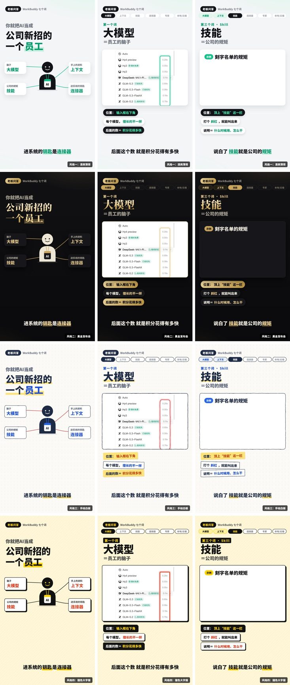

# 口播剪辑助手

**口播视频成片专家，干两件事：**

- **口播剪辑加包装成片**：你发来自己出镜的口播视频，AI 剪掉念错重来、语气词和长停顿，做人像全屏和圆角小窗切换、要点卡、金句卡、动态字幕和音效，直接出能发的成片。
- **口播科普视频成片**：你发想法和截图，AI 写口播稿，你录音（或发录好的录音、视频），AI 用软件截图配圈注动画，出科普视频。

四种包装风格，横版投大屏、竖版发视频号都能出。不做美颜，不加背景音乐（你后期自己加）。

版本：2.3.0 · 作者：彭迪 · 技能标识：voiceover-explainer

[公开仓库](https://github.com/pengdi190721-dot/tuojian-ai-plugins) · [查看完整技能](skills/voiceover-explainer/SKILL.md)

## 先分线：成片里谁是主角

| 你发来的 | 走哪条线 |
|---|---|
| 自己出镜说话的视频 | 口播剪辑加包装（人是主角） |
| 想法、提纲、截图，还没录 | 口播科普视频（截图动画是主角） |
| 录好的录音或视频，加截图，想做成科普动画 | 口播科普视频，跳过写稿 |

判断不了，AI 只问一句。每次回复开头都写“【A 线 · 第 2 步 / 共 4 步】”，你随时知道走到哪了。

## 口播剪辑加包装：4 步，只停 1 次

| 步骤 | 你做什么 | AI 做什么 |
|---|---|---|
| 1 发视频 | 发出镜口播视频，有截图一起发 | 统一尺寸、逐字听写、找出念错重来和语气词、看画面 |
| 2 定方案（停） | 看一条消息，回一句话 | 一条消息给齐：剪辑单（原话和时间、剪完多长、钩子建议）、用你自己画面做的 4 张模版图、栏目、横竖版 |
| 3 制作 | 等 | 剪辑（剪辑点都落在没声音的地方、跳剪推近藏起来）→ 全屏和小窗排版 → 片头和栏目角标、要点卡、三步卡、截图推近、金句卡、片尾“评论区聊聊吧” → 动态字幕 → 音效、音量拉平 → 逐句自查 → 渲染 → 成片重新听写核对字幕 |
| 4 交付 | 看成片，要改就说“第几秒改成什么” | 交成片和字幕文件，说清剪了什么、哪些卡片文字是提炼的；你要的话再出剪映草稿（试验功能） |

## 口播科普视频：6 步，停 3 次

| 步骤 | 你做什么 | AI 做什么 |
|---|---|---|
| 1 收想法和截图 | 发想讲的大致内容，有截图一起发 | 建项目、整理素材 |
| 2 定口播稿（停） | 改稿子、补截图 | 写口播稿，每段附“画面对照”，列出还缺的截图 |
| 3 录音（停） | 按稿子录音发过来（手机录就行），录好的视频也行 | 告诉你怎么录 |
| 4 定方案（停） | 看样片，回一句话 | 听写对稿、调好节奏，用你的声音出四种风格样片，一条消息问清风格、横竖版、栏目 |
| 5 制作 | 等 | 做完全部画面，逐句截图自查，渲染全片，重新听写核对字幕 |
| 6 交付 | 看成片 | 交成片和字幕文件 |

## 四种风格


从上到下：清爽薄荷（日常科普）、黑金发布会（投大屏）、手绘白板（讲原理）、撞色大字报（短视频）。两条线用同一套风格。竖版：



## WorkBuddy 专家包

在 WorkBuddy 里自己创建的专家：上传 `output/voiceover-explainer-独立技能包-版本号.zip` 更新版本即可（守则已在技能里）。要走开放平台上架，用这里的专家包，源文件在 `expert/`：

- `expert/agents/voiceover-explainer.md`：专家守则（正文由打包脚本从 `skills/voiceover-explainer/references/专家守则.md` 同步，改守则只改那一份）（分线、回复格式、两条线的步骤和停顿点、一条消息定方案、硬规矩、判断规矩、默认值、交付返修、出问题怎么办）
- `expert/.codebuddy-plugin/plugin.json`：专家配置（按 WorkBuddy 开放平台的专家包规范）
- `expert/avatars/`：头像，放你自己的（512×512 的 PNG 或 JPG，不超过 500KB）；没放头像时只出技能包，不出专家包

运行 `python3 scripts/build_release.py` 会按规范检查，并在仓库根目录的 `output/` 生成 `口播剪辑助手-专家包-版本号.zip`（里面带上完整技能），拿去 WorkBuddy 开放平台上架，或在企业版后台“上传企业专家”。

## 运行要求

- 剪视频、出成片要在自己电脑上运行（WorkBuddy 选本地模式），因为要装程序、跑浏览器出画面。还没视频时写口播稿、看口播文字出剪辑判断和包装方案，不用装任何东西，云端也能用。
- 第一次用会自动装需要的程序（国内镜像），再下载一个约 230MB 的中文语音识别模型，只下一次。
- 剪真人口播会装 opencv 4.x 用来找人脸（小窗跟着脸走）。
- 1 分钟的口播剪辑，从定方案到出片大约十几分钟；4 分钟的科普动画，渲染大约 10 分钟。

## 安装

### WorkBuddy

在WorkBuddy的对话或命令输入框中运行（不是电脑终端）：

```text
/plugin marketplace add pengdi190721-dot/tuojian-ai-plugins
/plugin install voiceover-explainer@tuojian-ai
```

### Codex

```bash
codex plugin marketplace add pengdi190721-dot/tuojian-ai-plugins
codex plugin add voiceover-explainer@tuojian-ai
```

## 最常用的口令

```text
请用口播剪辑助手。这是我出镜录的口播视频，帮我剪辑加包装，先给我剪辑单和模版图。
```

```text
剪辑单同意，模版一，竖版，开始做。
```

```text
请用口播剪辑助手。我想做一条讲清楚某个软件的科普视频，大致内容和截图发你，先帮我写口播稿。
```

```text
录音发你了，先出四种风格的样片给我挑。
```

## 维护说明

- 动画引擎和风格的源码在 `engine-src/`（科普动画用 css、js，口播剪辑用 koubo.html）。技能市场只收 .md、.yaml、.py，所以改完要运行 `python3 scripts/build_release.py`，把引擎打进 `skills/voiceover-explainer/scripts/engine_assets.py`，同时检查并构建插件包和独立技能包（在仓库根目录的 `output/`，不进仓库）。
- 加 `--跑检查` 会放出示例项目，真的跑一遍页面检查。

## 更新记录

- **2.3.0**（2026-11-11）：口播稿写得不生硬：新增“写稿要像本人”（参考创始人IP操盘手的写稿方法）——用户发了文字解释或语音，先用他自己的原话写，只补必要的连接话并列出来；不再每段套“在哪、是什么、举例、金句”的模子，金句整条 2 到 3 句，比喻可选；每条给 2 到 3 个开头备选；交稿前过一遍去生硬自查；除了拍摄版再给一份纯文字版（录音或提词器用）；用户改过的稿，比出改法存进工作目录的“口播写稿规则.md”，下次写稿先读。
- **2.2.0**（2026-11-09）：针对专家包“沙箱评测低质量”驳回：三条推荐提示词换成不用附件也能直接出东西的（写出镜口播稿、看一段口播文字判断怎么剪和包装、写截图科普的口播稿和画面对照）；新增“开拍前”（还没视频时写稿、看稿，不跑脚本）；守则改成每条回复都要有能直接用的东西，用户说发了文件却找不到时先交能做的；环境装不上不再只叫用户切本地模式，先交口播稿、剪辑单、包装方案、字幕稿；只有真要处理视频或录音才装环境；环境检查网络不通 20 秒内给结论，下载 20 秒没数据就换地址，不再卡住；没有语音识别模型时，准备脚本跳过听写，照样出开头结尾空白、长停顿和抽帧，不再报错退出。
- **2.1.2**（2026-11-09）：修专家包审核驳回（“内置文件缺失”）：文档里不再出现包里没有的占位路径（scripts/xxx.py 等），专家守则里的路径从包的最外层写起；截图在包装单里只写文件名；打包时自动跑一遍引用检查（scripts/check_refs.py）。
- **2.1.1**（2026-11-09）：专家守则放进技能（references/专家守则.md，SKILL.md 开头要求先读），在 WorkBuddy 里自己创建的专家上传这个技能包就能用上守则；专家包头像改成由作者自己放。
- **2.1.0**（2026-11-09）：改名“口播剪辑助手”（技能标识 voiceover-explainer 不变，已经装了的照常升级）；新增 WorkBuddy 专家包（专家守则单独成文：分线、该停才停、一条消息定方案、硬规矩、交付和返修），可上传到 WorkBuddy 开放平台或企业后台。
- **2.0.0**（2026-11-09）：新增“口播剪辑加包装成片”：收出镜口播视频，逐字听写找出念错重来和语气词出剪辑单，用用户自己的画面出四种风格模版图，一条消息定方案；自动剪辑（剪辑点落在没声音处、对齐整帧、跳剪推近）、人像全屏和圆角方形小窗切换（人脸居中）、片头栏目角标、要点卡、三步卡、截图推近圈注、金句卡、对比字、片尾行动卡、动态字幕、音效，成片重新听写核对；剪映草稿（试验，用户说要才出）。科普动画也收录好的视频（只用声音）。去掉美颜，不加背景音乐。
- **1.0.0**（2026-11-06）：第一版。五步流程（收想法和截图、确认口播稿、录音、看样片选风格、出片）；四种风格（清爽薄荷、黑金发布会、手绘白板、撞色大字报）；横竖版通用；小机器人、AI员工、老板三个角色；离线语音识别对稿、自动调节奏、合成音效、成片字幕核对。
