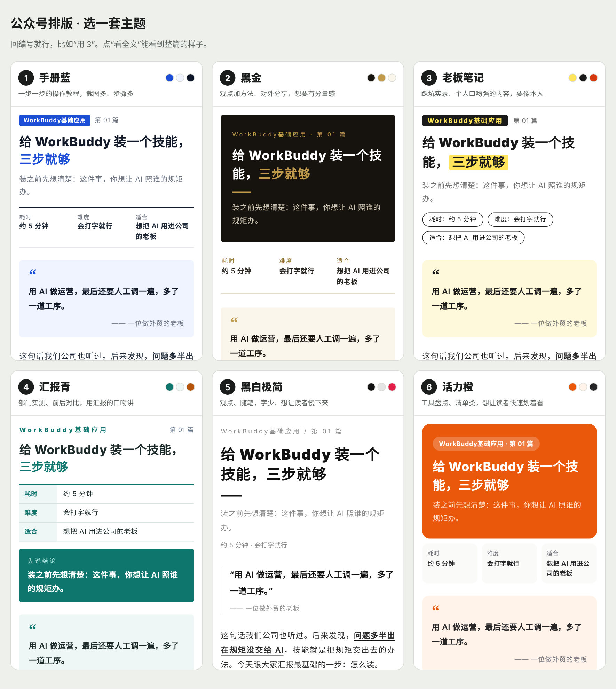

# 公众号图文排版

**把稿子和截图，做成能直接粘进微信公众号后台、粘过去不掉格式的图文。**

- **有完整稿子**：只排版，不动原文。AI 判断哪段是步骤、哪句当金句、哪张截图配哪一步、每段标哪几个关键词。
- **只有截图和几句要讲的**：AI 先看截图，照你的口吻写成完整文章，缺的事实标成「【待补】」让你补，不编成果、不编数字。

六套主题用缩略图挑，排完自动检查，出一个预览页，点“复制”就能粘进公众号后台。

版本：1.1.1 · 作者：彭迪 · 技能标识：wechat-article-layout

[公开仓库](https://github.com/pengdi190721-dot/tuojian-ai-plugins) · [查看完整技能](skills/wechat-article-layout/SKILL.md)

## 六套主题



| 编号 | 主题 | 适合 |
|---|---|---|
| 1 | 手册蓝 | 一步一步的操作教程，截图多、步骤多 |
| 2 | 黑金 | 观点加方法、问答、对外分享 |
| 3 | 老板笔记 | 踩坑实录、个人口吻强的内容 |
| 4 | 汇报青 | 实测对比、复盘汇报 |
| 5 | 黑白极简 | 短观点、随笔 |
| 6 | 活力橙 | 清单、工具盘点 |

用的时候不用记：没点名时 AI 会出一张六套缩略图给你挑，回编号就行。

## 怎么用

| 步骤 | 你做什么 | AI 做什么 |
|---|---|---|
| 1 发东西 | 发稿子，或者截图加几句要讲的 | 分清是只排版还是先写稿 |
| 2 挑主题 | 看缩略图，回编号 | 按文章类型推荐一套；第一次用顺便问署名和栏目 |
| 3 等 | 等 | 截图编号对位、写稿（需要时）、加排版标记、排版、自动检查 |
| 4 粘贴 | 打开预览页，点「复制（带截图）」，去后台粘贴 | 告诉你用了哪套主题、哪些地方请你核对、还有哪些图和信息待补 |

截图没跟着进后台：回预览页点「复制（截图留空位）」重新粘，每张图的位置留了空框，照图号补图就行。

## 你的设置

在你放稿子的文件夹里建一个「公众号设置.md」，写上：

```
默认主题：1
栏目：软件实操
署名：我是小王，开了三家烘焙店，把用 AI 管门店的过程讲给同行听。
互动尾：评论区聊聊吧
读者：开小店、想用 AI 但还没用起来的老板
口吻：口语化，用“我们”，多讲为什么，不讲大道理
```

第一次用时 AI 会问你，帮你建好。放在你自己的文件夹里，技能升级不会冲掉。

## 颜色会不会变

颜色都写在每个文字、色块自己身上，全是纯色，粘进后台会原样保留。会变的只有两处：

- 读者开了深色模式，微信会自动把浅底调深、深字调浅，所有公众号都这样。每套主题都守了“深色块配浅字、浅色块配深字”，调完还看得清。
- 公众号正文统一用手机自带字体，细体数字在部分安卓手机上会粗一点。

## 安装

### Codex

在电脑终端依次运行：

```bash
codex plugin marketplace add pengdi190721-dot/tuojian-ai-plugins
codex plugin add wechat-article-layout@tuojian-ai
```

已经添加过这个市场的，先运行 `codex plugin marketplace upgrade tuojian-ai` 再安装。

### WorkBuddy

在WorkBuddy的对话或命令输入框中运行（不是电脑终端）：

```text
/plugin marketplace add pengdi190721-dot/tuojian-ai-plugins
/plugin install wechat-article-layout@tuojian-ai
```

也可以用独立技能包：在源码仓库运行 `python3 plugins/wechat-article-layout/scripts/build_release.py`，在仓库根目录的 `output/` 拿到 `wechat-article-layout-独立技能包-版本号.zip`，到“技能→添加技能→上传技能”导入。技能包里只有 .md、.yaml、.py 文件。

## 第一次用，复制这句

```text
请用公众号图文排版。我发几张截图和几句要讲的内容，帮我写成一篇公众号图文再排版，先给我看主题缩略图。
```

```text
请用公众号图文排版。这篇稿子已经写好了，帮我照原文排成公众号图文，不要改内容。
```

## WorkBuddy 专家包

专家名叫“公众号图文排版助手”。在 WorkBuddy 里自己创建的专家：上传 `output/wechat-article-layout-独立技能包-版本号.zip` 更新版本即可（守则已在技能里）。要走开放平台上架，用这里的专家包，源文件在 `expert/`：

- `expert/agents/wechat-article-layout.md`：专家守则（正文由打包脚本从 `skills/wechat-article-layout/references/专家守则.md` 同步，改守则只改那一份）
- `expert/.codebuddy-plugin/plugin.json`：专家配置（按 WorkBuddy 开放平台的专家包规范）
- `expert/avatars/wechat-article-layout.png`：头像（512×512 的 PNG 或 JPG，不超过 500KB）；没放头像时只检查、不出专家包

运行 `python3 scripts/build_release.py` 会按规范检查，并在仓库根目录的 `output/` 生成 `公众号图文排版助手-专家包-版本号.zip`（里面带上完整技能），拿去 WorkBuddy 开放平台上架，或在企业版后台“上传企业专家”。

## 更新记录

- **1.1.1**（2026-11-11）：改回“先选主题再排版”：排版之前一定先发六套缩略图和推荐，用户选好编号再排（用户点名了主题或说“你定”才不停）；写稿再排时，稿子全文、“请你核对”、截图对不上的、要不要加署名都放进选主题那一条消息，回一句就能定稿定主题。专家包推荐提示词跟着改；放上专家头像，出专家包。
- **1.1.0**（2026-11-11）：新增 WorkBuddy 专家包“公众号图文排版助手”（专家守则单独成文：分线、每条回复都有能直接用的东西、两条线一口气做完、硬规矩、交付返修、出问题怎么办），守则放进技能（references/专家守则.md），自己创建的专家上传技能包就能用上。流程调整：选主题不再停下来问，没点名就按文章类型推荐一套直接排，交付时附六套缩略图，想换回编号；写稿再排不再等确认，带着“请你核对”一起交；截图对不上、署名没设也不停，放进交付消息。
- **1.0.0**（2026-11-11）：首个版本。两种用法（只排版 / 写稿再排）；六套主题，用缩略图挑（现场生成，技能里不放图片）；截图编号对位，缺图留空位；原话卡、步骤、踩坑提醒、前后对比表、金句；中文标点自动转全角；排完自动检查公众号格式；预览页一键复制，截图进不去可以留空位；用户设置放自己文件夹，升级不冲掉。
